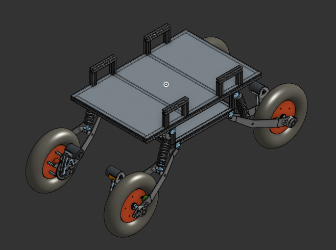
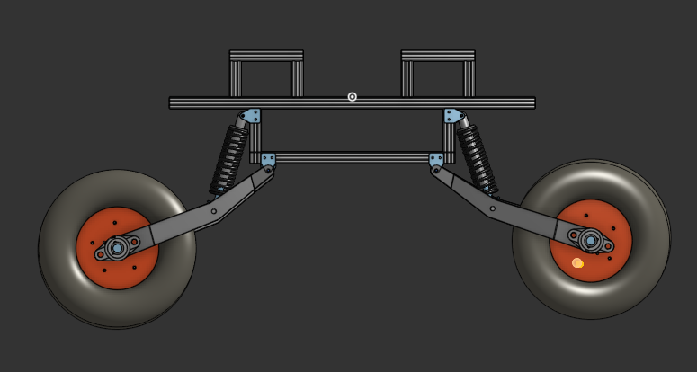
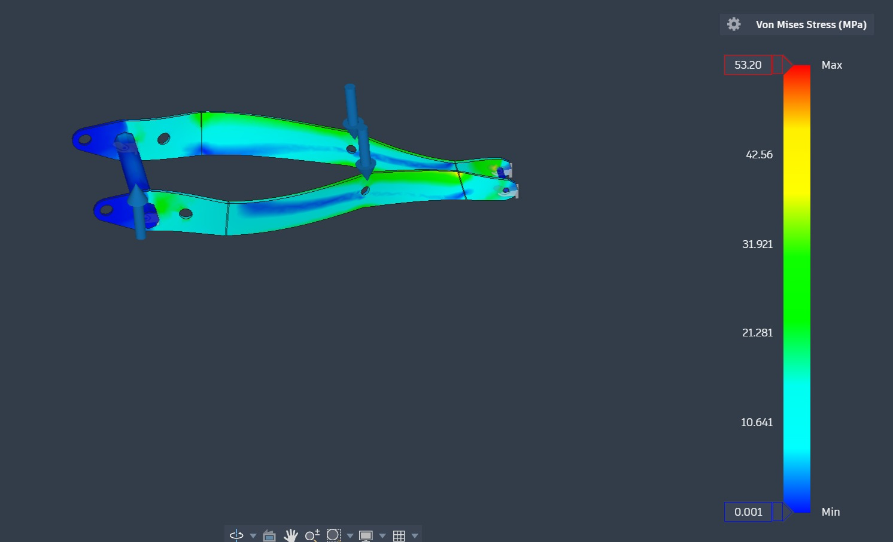
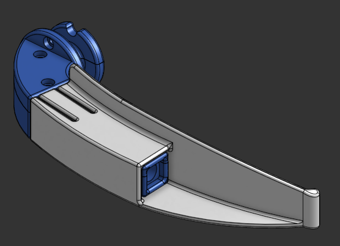
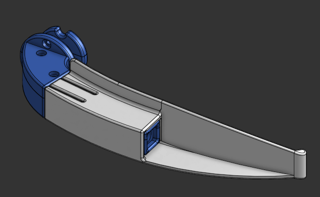
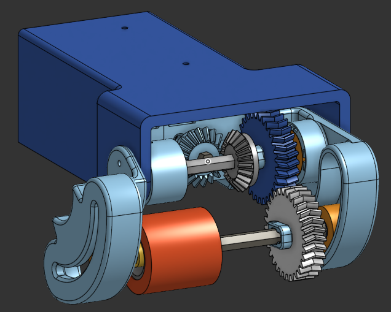
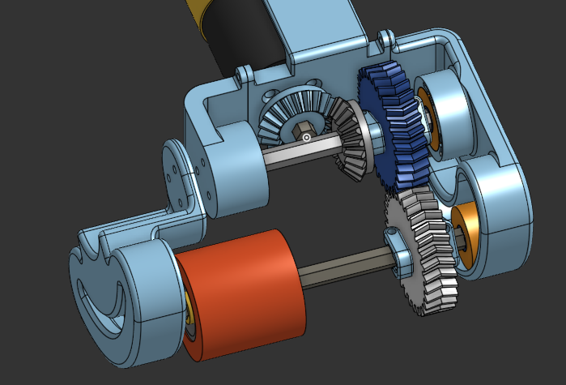
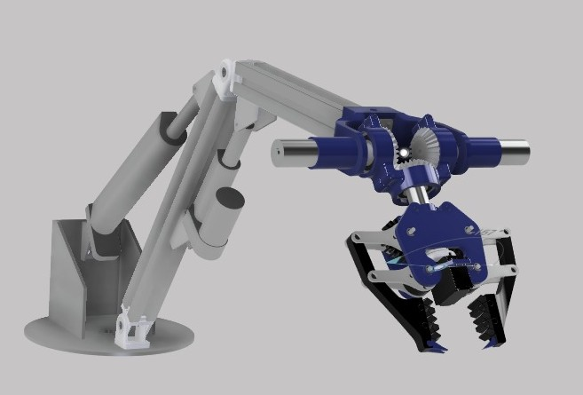
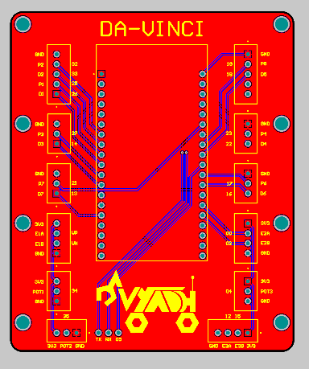

# Robotics-Portfolio

This repository indexes my major hands-on engineering projects in robotics, embedded systems, PCB design, and mechanical CAD.

---
## Off-road UGV Mechanical Design (Internship)

**100 kg payload off-road unmanned ground vehicle for last-mile defence logistics, 30 km/h top speed**

<table>
<tr>
<td width="50%" valign="top">

</td>
<td width="50%" valign="center">

</td>
</tr>
</table>

- **Role:** Chassis, suspension and drivetrain design, fabrication lead
- **Software:** Onshape (CAD), Ansys (FEA)
- **Context:** Internship, Vrischik Technologies
- **Repo:** [UGV-design](https://github.com/GitMasterLOL/offroad-ugv-mechanical-design)

**Key points**
- 60 kg aluminium T-slot and sheet metal chassis, for balancing load and structual rigidity
- Mild steel trailing arm suspension, deformation checked under full payload in Autodesk Fusion
- Chain drive with custom motor and sprocket mounts
- Demonstrated at the National Defence Conclave (T-Works, Hyderabad)

Full design details are in the repo above.

*von Mises Stress analysis on the trailing arm*

---
## Video Laryngoscope (Freelance)

**Curved Macintosh-style single-use video laryngoscope blades in sizes 2 to 4, with an independent, reusable camera holder, designed to mate with a client-supplied handle**

<table>
<tr>
<td width="50%" valign="top">

</td>
<td width="50%" valign="top">

</td>
</tr>
<tr>
<td width="50%" valign="middle">

</td>
<td width="50%" valign="top">

</td>
</tr>
</table>

- **Role:** Sole CAD designer for the blade and camera holder
- **Software:** Onshape
- **Context:** Freelance contract, client confidential
- **Repo:** [video-laryngoscope-cad](https://github.com/GitMasterLOL/video-laryngoscope-cad)

**Key design points**
- **Size scaling:** Blade length changes across Macintosh sizes 2, 3, and 4 while the camera holder section stays the same for all sizes so any blade can be used with the holder.
- **Camera integration:** The camera holder is made in two parts for ease of assembly. They are joined by bolts near the handle mount. The blade tip is angled 1.5 degrees away from the camera axis to reduce blade occlusion in the image.
- **Handle interface:** The handle encloses a section of the camera holder, forming a semi-permanent joint, while the blades remain replaceable.
- **Manufacturing:** Prototypes were 3D printed in PETG. The intended production process is injection molding in polycarbonate (PC), so the walls are a uniform 2 mm.

**Status:** Delivered CAD models.

---
## CNC Auto Door Retrofit (Design Exercise)

**Retrofit mechanism that automates a horizontally sliding CNC machine door using a compliant friction roller on the door's top edge. Sized for a 21.5 kg and a 5 s open/close cycle.**

<table>
<tr>
<td width="50%" valign="top">

</td>
<td width="50%" valign="top">

</td>
</tr>
</table>

- **Role:** Sole designer
- **Software:** Onshape
- **Context:** Take-home design challenge for a CNC automation company
- **Repo:** [cnc-auto-door-retrofit](https://github.com/GitMasterLOL/cnc-auto-door-cad)

**Key design points**
- **Drive principle:** A silicone roller runs on grip tape stuck to the door's top edge. The mechanism has a fixed size, so only the length of tape changes with door length and the module scales to any stroke.
- **Standoff adjustment:** The roller sits in a 90 degree circular slot with 45 mm of vertical travel, so it can reach the door's top edge on machines with different mounting heights.
- **Clamping:** A cutout in the slot lets a bolt clamp the roller down onto the door's top surface to set the grip force.
- **Compact packaging:** A bevel gear stage turns the drive through 90 degrees so the encoded goBILDA 5203 motor (312 RPM) lies along the door. The module fits in 220 x 160 x 105 mm.
- **Sizing:** The motion profile (0.8 s accel, 3 s cruise, 1.2 s decel) gives a 400 mm/s peak. For a 21.5 kg door the peak force at the roller is about 12 N, so the clamp must supply at least 11 N at the conservative tape friction of 1.05. Design clamp force: [x] N.
- **Limitations:** Grip tape and roller wear, so both need periodic replacement. Clamp force can drop over time if the door's top face is not flat (Hertzian contact), so the bolt needs periodic retightening.

**Concepts considered**

| Concept | Verdict | Reason |
|---|---|---|
| Friction roller on grip tape | Selected | Fixed-size mechanism, only the tape length changes with door length |
| Rack and pinion | Rejected | Very long racks are impractical and limit scalability |
| Lead screw | Rejected | Long screws are costly and the assembly is bulky |
| Belt drive | Rejected | Non-standard belt loop requirement, belt tensioning and the torque transfer mechanism are costly, bulky, and more complicated to assemble and maintain |

**Status:** Design exercise. CAD, manufacturing drawings and BOM complete. Not built or tested.

Design report, STEP assembly, manufacturing drawings and BOM are in the repo.

---
## Motor Driver Enclosure with Active Air Cooling
🔗 Repo: [Motor Driver Enclosure](https://github.com/GitMasterLOL/Motor-Driver-enclosure)

**Project overview:**
Mechanical design of a compact motor driver enclosure incorporating magnetic holders and forced-air cooling to improve thermal performance and reliability in high-current unstable operation.

**My contributions:**
- Designed a 3D CAD enclosure optimized for stability, airflow, component accessibility, and mounting constraints
- Integrated a fan-based cooling path
- Considered manufacturability, cable routing, and maintenance access in the
  mechanical layout

**Key skills demonstrated:**
Mechanical CAD, enclosure design, thermal considerations, practical manufacturability

---
## Vyadh Robotic Arm (Team Project)

**5-DOF remotely controlled robotic arm with a 10 kg payload and 1 m reach. I was the head of the Robotic Arm domain, and I worked on its electronics, firmware, hardware, and the ROS2 software**

<table>
<tr>
<td width="50%" valign="top">

*Arm used in the year 2025-26*

</td>
<td width="50%" valign="top">

*Arm used in the year 2026-27*

</td>
</tr>
</table>

- **Role:** Robotic arm head, 1.5 years
- **Software:** Autodesk Fusion, Onshape, ROS2, ESP32 firmware (ESP-NOW), Altium Designer
- **Context:** Team Vyadh, VIT's Mars rover team
- **Team:** Led 5 juniors across the electronics and software subteams
- **Repo:** [Vyadh-Robo-Arm](https://github.com/GitMasterLOL/Vyadh-Robo-Arm)

### Electronics and firmware
- Each joint is run by an ESP32 module connected to a Cytron MD10C driver and an AS5600 absolute positional encoder. The modules talk over Bluetooth to an onboard laptop which runs the ROS2 framework.
- I chose ESP32 & Bluetooth over USB or UART so that the microcontrollers can be reconfigured as needed without issues with wiring
- I designed a breakout board for an ESP32 to organise the wiring which takes an external 12V supply for power.

### Software
- I wrote a custom ROS2 message interface layer from scratch, so every arm subsystem uses one common standard with two custom message types over 3 nodes. This let the electronics and software subteams work in parallel without breaking each other's code.
- Encoder resolution at the joint output is 11.4 counts per degree.

### Mounts and wiring hardware
- I designed the motor driver holders, wiring organisers and encoder mounts, 3D printed in PLA. They are built so they can be dynamically reorganised to reduce clutter and improve wiring.

### Team and leadership
- I led 5 juniors and set the component selection criteria and integration standards, including the actuators which were selected to maximize speed for the required torque spec while keeping the weight down.
- I designed the architecture of a CAN bus communication protocol (token ring, with a node state machine) for the arm's modules. My juniors took over the implementation after I left.

---
## Portable Oscilloscope PCB
🔗 Repo: [PocketScope](https://github.com/GitMasterLOL/PocketScope)

**Project overview:**
Design of a compact, low-cost oscilloscope intended for learning mixed-signal circuit design, signal conditioning, and noise management in embedded measurement systems.

**Work done:**
- Designed multiple PCB revisions focusing on analog front-end layout, power integrity, and ADC signal routing
- Implemented input scaling to measure higher-voltage signals using low-voltage microcontroller ADCs
- Iterated on board layout to reduce noise, ground bounce, and coupling between digital and analog sections

**Key skills demonstrated:**
PCB design, mixed-signal electronics, schematic capture, hardware debugging mindset

**Pending work:**
Housing design, Communication system, GUI design for signal visualization
